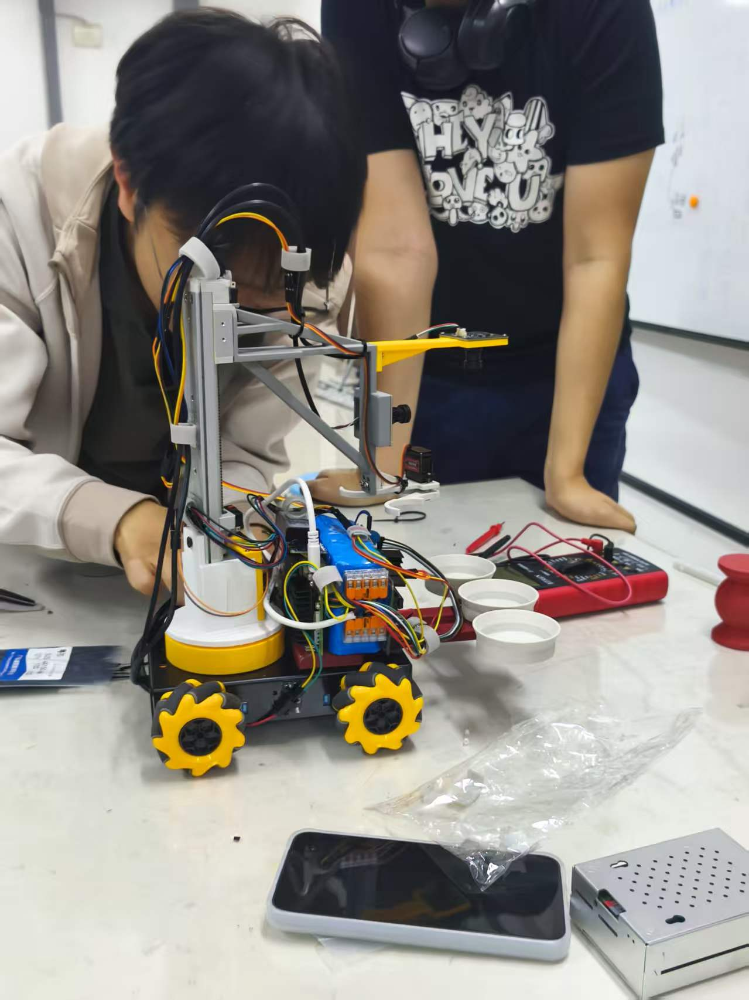
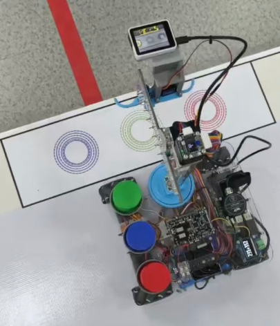

# Intelligent Logistics Handling Robot

Software for an autonomous logistics-handling robot developed across two
competition iterations, progressing from an Arduino/ESP32-based prototype to
a Raspberry Pi + STM32 architecture.

**Technologies:** Rust, C/C++, Python, STM32, ESP32, Arduino, Raspberry Pi, and
MaixCam.

The robot won **1st Prize** in the Intelligent Logistics Handling category at
the 2026 Beijing Universities Engineering Practice & Innovation Ability
Competition.

## Robot photos + footages
### School round robot


### City round robot



## Project layout

### `city_round_2026/`

- `robot_sbc/` — Rust control and decision-making program for the Raspberry Pi;
  includes device drivers, task execution, and a terminal dashboard. The
  approximately 5,000-line software stack handles high-level control,
  autonomous task execution, sensor integration, and communication with the
  STM32.
- `robot_stm32/` — STM32F103 firmware for robot hardware and serial
  communication.
- `robot_maixcam/` — MaixCAM color/shape detection application.
- `robot_sbc/docs/` — Competition task definitions and a robot structure
  diagram.

The city-round system brings together mecanum-wheel motion control, PID
control, pure-pursuit path following, QR recognition, IMU-based orientation
control, and autonomous task sequencing.

### `school_round_2026/`

- `clanker_rpi/` — Raspberry Pi Python application, including robot actions,
  computer vision, and a FastAPI control server.
- `clanker_esp32/` — ESP32 motor and servo firmware.
- `clanker_stm32/` — Arduino-compatible controller firmware.

The earlier prototype implemented robot control and autonomous task sequencing
with Arduino C/C++ and ESP32, including DC motor control, servo actuation, and
display/stepper control.

## Getting started

### Cloning the code

The component directories have independent Git histories and are registered as
Git submodules. Clone the project and its components with:

```sh
git clone --recurse-submodules <parent-repository-url>
```

For an existing clone, initialize the components and check out the commits
recorded by the parent repository with:

```sh
git submodule update --init --recursive
```

The parent repository pins each component to a specific commit, so this also
syncs existing submodules to the versions used by the project.

Build the city-round SBC program with Rust (edition 2024):

```sh
cd city_round_2026/robot_sbc
cargo build --release
```

Install the school-round Raspberry Pi dependencies and start its server:

```sh
cd school_round_2026/clanker_rpi
python -m pip install -r requirements.txt
python main.py
```

The server listens on port `8000`. Run the Raspberry Pi program on the robot
with its required camera and hardware connections.

The STM32 and ESP32 projects use PlatformIO. From a firmware project directory:

```sh
pio run
```

To upload firmware, connect the target board and use `pio run -t upload`.
`robot_maixcam/` is a MaixCAM application; open it with the MaixCAM development
tools to deploy it to the device.

## Notes

- The city-round SBC QR/camera drivers are Linux-specific; build and run that
  program on a compatible Linux system such as the robot's Raspberry Pi.
- Firmware builds and uploads require the corresponding PlatformIO platform,
  board, and hardware.
- See the individual project folders and their configuration files for
  project-specific details.
